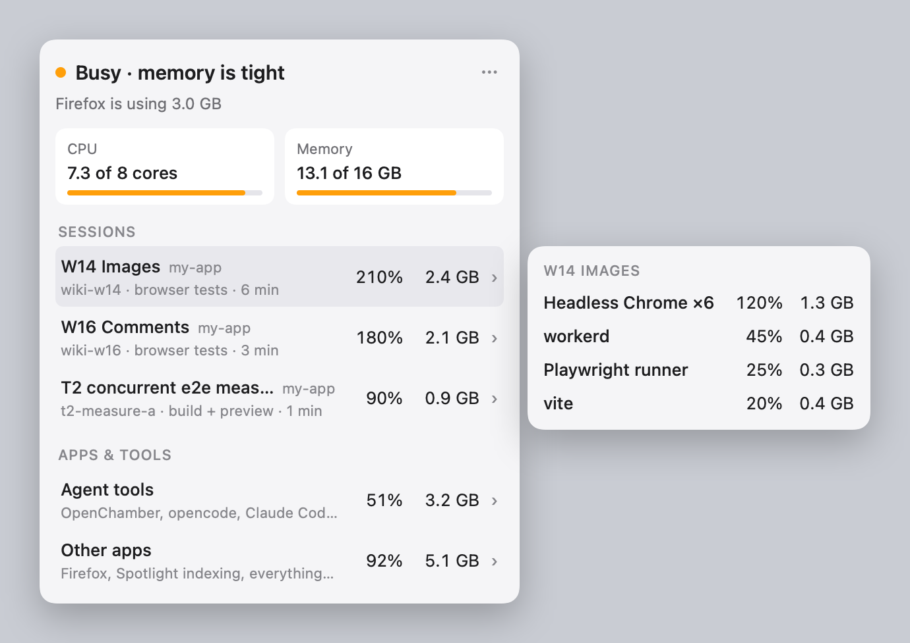

# Agent Load

**See which AI agent session is slowing down your Mac, from the menu bar.**



*Rendered from the app with illustrative sample numbers.*

**[Build it from source →](#install)** · macOS 14+ · no Xcode needed

## Know who is using your Mac

- **See the strain at a glance.** A coloured dot and a session count sit next to Wi-Fi and
  battery: green is calm, amber means wait, red means free something up.
- **Find the culprit.** Every unfinished OpenCode / OpenChamber session gets a row with its
  CPU and memory. When the Mac is strained, the line under the headline names the biggest
  user, even when it's another app such as a browser.
- **Look inside a session.** Hover a row to see its programs: headless Chrome, test
  runners, dev servers. Click it to open the session's folder in Finder.

## Install

Needs macOS 14 or later and the Xcode Command Line Tools (`xcode-select --install`).
Full Xcode is not required.

```sh
git clone https://github.com/simonhimself/agent-load.git
cd agent-load
scripts/install.sh              # builds it, installs it in /Applications and starts it
```

The dot appears in the menu bar. Run `scripts/install.sh` again after pulling changes to
update the installed app. To start it at login, choose **… → Open at Login** in the dropdown.

## How to use it

1. Glance at the dot: the number is how many agent sessions have unfinished work.
2. Click it for the breakdown: status, CPU and memory gauges, one row per session, then
   **Agent tools** (OpenChamber, opencode, Claude Code) and **Other apps**.
3. Hover any row for its details. The **…** button top-right has **Open at Login** and **Quit**.

CPU is shown per core: 100% is one full core, so 8 cores give 800%. The CPU gauge shows
demand over the last minute, including programs waiting for a turn, so it can exceed the
core count and won't always equal the sum of the rows.

## How it works

Every few seconds the app reads the process list. Each command an agent runs starts as a
shell under the opencode server, so the app follows every program up to that shell and
looks up the exact command text in opencode's local database, opened read-only, to find
which session sent it. Sessions that are thinking or waiting on sub-sessions are taken from
the same database.

- **Light footprint:** refreshes every 10 s while closed and every 3 s while open, at well
  under 1% CPU.
- **Memory first:** the status colour follows macOS memory pressure, and heavy active
  swapping, before CPU load, because on a 16 GB machine memory usually runs out first. The
  memory card shows "Swapping N MB/s" while memory is moving to and from disk.
- **Never writes:** the app only reads processes and the database; it can't stop anything.

Details, the attribution rules and diagnostic commands are in
[How it works](docs/HOW-IT-WORKS.md).

## Develop

```sh
scripts/test.sh                                          # Swift Testing unit tests
"build/Agent Load.app/Contents/MacOS/AgentLoad" --dump   # live snapshot as text
```

`scripts/test.sh` passes the extra framework flags Swift Testing needs when only the
Command Line Tools are installed.

## Limitations

- Recognises sessions run through OpenCode / OpenChamber only. Claude Code or Codex
  started on their own count under "Claude Code" or "Everything else".
- Commands shorter than two refreshes never get their own row; their CPU lands in
  "Everything else".
- Programs that lost their parent are matched to a session only inside `*-wt/<name>`
  worktree folders.
- Memory per row includes swapped-out memory, so rows can add up to more than
  "Memory used".
- Relies on opencode's internal database layout. If that changes, rows fall back to folder
  names.
- Read-only: it doesn't stop processes, send notifications, or start at login by itself.

## Project guide

| File | Purpose |
| --- | --- |
| [`docs/HOW-IT-WORKS.md`](docs/HOW-IT-WORKS.md) | Sampling, attribution, memory figures, diagnostics, source layout |
| [`docs/design.md`](docs/design.md) | Agreed design: status rules, listing rules, every dropdown element |
| [`docs/mockup.html`](docs/mockup.html) | Approved visual reference |
| [`scripts/build-app.sh`](scripts/build-app.sh) | Builds and ad-hoc signs the `.app` |
| [`scripts/install.sh`](scripts/install.sh) | Builds, installs in `/Applications` and starts the app |
| [`scripts/test.sh`](scripts/test.sh) | Runs the unit tests |
