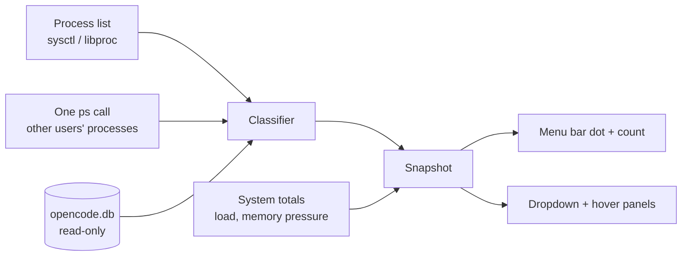

# How Agent Load works

Technical reference for [Agent Load](../README.md). The agreed product design and every
display rule live in [`design.md`](design.md); the approved look is [`mockup.html`](mockup.html).

## Data flow



## Sampling

- Every 3 s while the dropdown is open, every 10 s while it is closed.
- The process list, CPU time and memory footprint are read in-process (`sysctl
  KERN_PROC_ALL`, `proc_pid_rusage`). Processes owned by other users (for example
  Spotlight's `mds`) cannot be read that way, so the app makes one
  `/bin/ps -o pid=,time=,rss=` call per refresh for those.
- CPU % per row: CPU time used since the last sample, divided by the time between samples;
  100% = one full core. New processes are measured over at least 1 s and capped at all cores.
- System status: memory pressure (`kern.memorystatus_vm_pressure_level`) first, then the
  1-minute load average against the core count. The amount in swap never changes the colour,
  because it lingers after a crunch. Active swapping does: the memory card shows
  "Swapping N MB/s" from 1 MB/s, and 30 MB/s or more in two consecutive refreshes turns
  memory amber ("memory is swapping").
- One refresh costs roughly 12 ms of CPU; the app idles well under 1% CPU and about 20 MB of
  memory.

## Attributing programs to sessions

1. Every command an agent runs starts as a shell (`zsh … -c <command>`) under
   `opencode serve`, the `opencode-pty` daemon, or a `claude` process. That shell and all its
   descendants belong to one session.
2. The session is found by looking up the exact command text (JSON-escaped, matched with
   `instr`) in opencode's database, `~/.local/share/opencode/opencode.db`, table
   `session_message`, joined to `session_v2` for title and folder. The lookup is restricted
   to messages written shortly before the shell started, and cached per shell.
3. Programs that lost their parent but run inside a `*-wt/<name>` worktree folder are
   assigned to the session that mentions that folder most in its recent messages.
4. Classification order matters because everything descends from OpenChamber: terminal
   harness sessions first (below), then session shells, then `claude` processes, then the opencode server and service, then the OpenChamber
   app itself, then the Claude desktop app ("Claude app"), then Cua, then other apps grouped by their `.app`
   bundle, then everything else.
5. The Claude desktop app counts as an agent tool: every process inside Claude.app, and every
   helper outside the bundle whose responsible process (as Activity Monitor groups helpers) is
   Claude.app. That includes the `com.apple.Virtualization.VirtualMachine` process of the VM it
   runs its local agent work in. Other apps' VMs use the same executable but have a different
   responsible process (e.g. `limactl` for Lima/Colima), so they stay where they were.
6. Cua is an agent tool too: processes inside Cua Spaces.app, executables under `~/.cua/` (its
   Lima/Colima runtime, e.g. `limactl hostagent`), commands whose first word points there (the
   `ssh: ~/.cua/…/ssh.sock [mux]` to its VM), and helpers whose responsible process is one of
   those (its Virtualization.framework VM). Lima/Colima installed elsewhere is not Cua.

## Harnesses and terminal sessions

Each row names the tool that runs it with its icon:

- **OpenChamber or OpenCode**: both use opencode's database. A session is OpenChamber's when it
  or an ancestor session has an `"openchamber"` key in `session_v2.metadata` (written as soon as
  OpenChamber creates a session), or when its shell runs under the `opencode serve` that
  OpenChamber.app started. Sessions with neither are OpenCode's. The `metadata` column is probed
  separately; without it only the process-tree signal is used.
- **Claude Code, Codex, Pi started on their own**: a `claude`, `codex` (npm wrapper or native
  binary) or `pi` process with no opencode process above it. It and all its descendants form one
  session. CLIs inside an app bundle and `codex app-server` (desktop apps) are not terminal
  sessions.
- **Transcripts** (read-only, under `~/.claude`, `~/.codex`, `~/.pi`):
  - Claude Code: `~/.claude/projects/<cwd, every non-alphanumeric character as "-">/<id>.jsonl`;
  - Codex: `~/.codex/sessions/YYYY/MM/DD/rollout-…-<id>.jsonl`, matched by the `cwd` in its first
    line, titles from `~/.codex/session_index.jsonl`;
  - Pi: `~/.pi/agent/sessions/--<cwd with / as ->--/<time>_<id>.jsonl`.
  A process uses the file named in its arguments (`--resume`, `--session-id`, `resume <id>`,
  `--session`), else a file in its folder created after it started (each file goes to the
  latest-started process older than it). Claude Code files written for opencode (entrypoint
  `sdk-ts`) are skipped. A new file is read at its head and tail (128 KB each), then only the
  bytes appended since; unchanged files are not read.
- **Shown only while working**: ≥ 1% CPU in the last sample, or the transcript was written in the
  last 2 minutes. Otherwise its processes count under "Everything else".

## Which sessions are listed

A session gets a row while its work is not finished:

- it has running programs (including ones that only sleep or wait), seen in two consecutive
  refreshes to avoid flicker; or
- OpenChamber marks it busy (`time_busy > time_idle`), unless that flag has had no sign of
  life for 12 h; or
- one of its sub-sessions qualifies (shown as "waiting for N sessions").

Rows are sorted by CPU, or by memory while memory is the problem. When the status is amber
or red, the line under the headline names the biggest user of the resource that is short.

## Memory figures

- Per-row memory is the footprint, as in Activity Monitor. Footprints include compressed
  and swapped-out memory, so the rows can add up to more than "Memory used".
- "Everything else" is the sum of its own processes. A process whose footprint is more than
  1 GB above its resident size (mostly swapped out, for example a virtual machine) counts
  with its resident size.
- The "Claude app" and "Cua" agent tools rows use the same guard (only these rows): a VM's footprint counts
  guest memory that is mostly not resident (e.g. 12 GB footprint, 0.4 GB resident).
- Processes owned by other users show resident memory, because macOS does not let a normal
  app read their footprint.

## Why "Everything else" can be large

Its CPU is the machine total minus everything listed, so it collects macOS itself
(WindowServer, audio, Control Center and hundreds of small daemons), kernel work such as
compressing and swapping memory, and very short commands that start and finish between two
samples. Part of it is therefore real session work that is too short to catch.

## Diagnostics

```sh
APP="build/Agent Load.app/Contents/MacOS/AgentLoad"
"$APP" --dump        # full snapshot as text, including every process per row
"$APP" --verify-db   # checks that the command lookup matches recent commands
"$APP" --bench       # cost of one refresh
"$APP" --render-png /tmp/a.png [--hover | --hover-tools | --hover-other | --hover-thinking | --hover-waiting] [--dark] [--mockup-data]
```

`--mockup-data` renders the illustrative numbers from `docs/mockup.html` instead of live data.
`--hover-claude` hovers the first Claude Code row.
`AgentLoad --debug-click` presses the menu bar item through its real action after 4 s (to check
that it stays highlighted while the dropdown is open). `--debug-open [--debug-hover]` opens the
dropdown (and hovers the first row); add `--debug-dark` for dark appearance. Renders draw a flat
background; the live window uses the translucent menu material.

## Source layout

| Path | Purpose |
| --- | --- |
| `Sources/AgentLoadCore/ProcessReader.swift`, `SystemStats.swift` | Reading processes and system totals |
| `Sources/AgentLoadCore/SessionDB.swift` | Read-only queries against opencode's database |
| `Sources/AgentLoadCore/Harness.swift`, `Transcripts.swift` | Which tool runs a session; terminal sessions' transcripts |
| `Sources/AgentLoadCore/Classifier.swift` | Assigning every process to exactly one row |
| `Sources/AgentLoadCore/SessionListing.swift` | Which sessions are listed, and their order |
| `Sources/AgentLoadCore/SnapshotBuilder.swift`, `Status.swift` | Rows, totals, status colour and culprit line |
| `Sources/AgentLoad/` | Menu bar item, dropdown, hover panels, `--dump` and `--render-png` |
| `Tests/AgentLoadCoreTests/` | Swift Testing suite (run with `scripts/test.sh`) |
